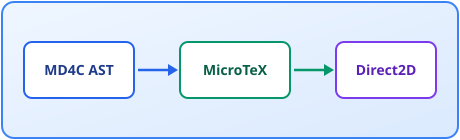

# MarkReader 视觉与排版综合测试

这是一个用于验证 **MarkReader** 渲染质量、字号缩放、数学公式、图片与 SVG、代码块及大纲目录的测试文档。

## 1. 数学公式（行内与行间居中）

行内公式测试：质能方程 $E = mc^2$，二次求根公式 $x = \frac{-b \pm \sqrt{b^2 - 4ac}}{2a}$，以及求和符号 $\sum_{i=1}^n i = \frac{n(n+1)}{2}$ 与文本基线对齐。

行间居中公式（高斯积分与傅里叶变换）：

$$
\int_{-\infty}^{+\infty} e^{-x^2}\,dx = \sqrt{\pi}, \qquad \hat{f}(\omega) = \int_{-\infty}^{\infty} f(t)\, e^{-i\omega t}\,dt
$$

矩阵与分段函数：

$$
R(\theta) = \begin{pmatrix} \cos\theta & -\sin\theta \\ \sin\theta & \cos\theta \end{pmatrix}, \qquad |x| = \begin{cases} x, & x \ge 0 \\ -x, & x < 0 \end{cases}
$$

## 2. 矢量 SVG 与位图显示




## 3. 行内代码与语法高亮代码块

行内代码例如 `D2D1_DRAW_TEXT_OPTIONS_ENABLE_COLOR_FONT` 和 `git status`。

```cpp
#include <iostream>
#include <vector>

// 计算向量点积
double dot_product(const std::vector<double>& a, const std::vector<double>& b) {
    double sum = 0.0;
    for (size_t i = 0; i < a.size(); ++i) {
        sum += a[i] * b[i];
    }
    return sum;
}
```

## 4. 提示框与表格

> [!IMPORTANT]
> 纯原生 C++20 + Direct2D / DirectWrite 渲染，无需 WebView 或 Electron，支持自由缩放字号与切换主题。

| 特性 | 实现方案 | 状态 |
| :--- | :---: | ---: |
| 数学公式 | MicroTeX + DirectWrite | 已支持 |
| 矢量图 / 位图 | Direct2D SVG + WIC | 已支持 |
| 侧栏大纲 | 实时滚动追踪 + 点击跳转 | 已支持 |
